# 即時字幕 使用說明

即時字幕會把旁邊的人說的話，即時變成大字幕顯示在手機上，還會標出是誰在說話（A、B、C）。適合聽不清楚的時候，例如吃飯聊天、看醫生、看電視。

> 截圖用 Android 版、預設字級和淺色外觀拍的。字幕內容是測試用的對話，名字「Mama」只是範例。

## 安裝與第一次使用

1. 安裝方式請看 [安裝說明](install-android.md)（收到 APK → 允許安裝 → 安裝）。
2. 打開「即時字幕」，按下方綠色的「開始」。

   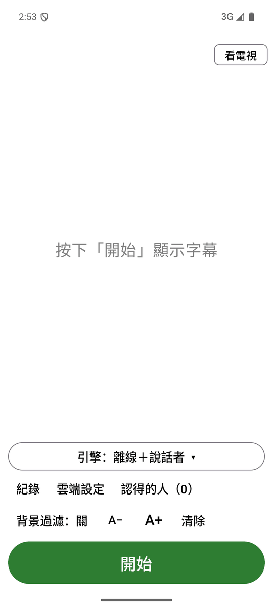

3. 手機會問兩件事：
   - 「要允許『即時字幕』錄音嗎？」→ 選「使用應用程式時」。不允許的話，字幕聽不到聲音。
   - 「要允許『即時字幕』傳送通知嗎？」→ 選「允許」。螢幕關掉時也能繼續聽。
4. 第一次會下載離線辨識模型（約 160 MB），畫面會顯示「正在下載離線模型…」。請先連上 Wi-Fi。下載完就不需要網路，也不花錢。

   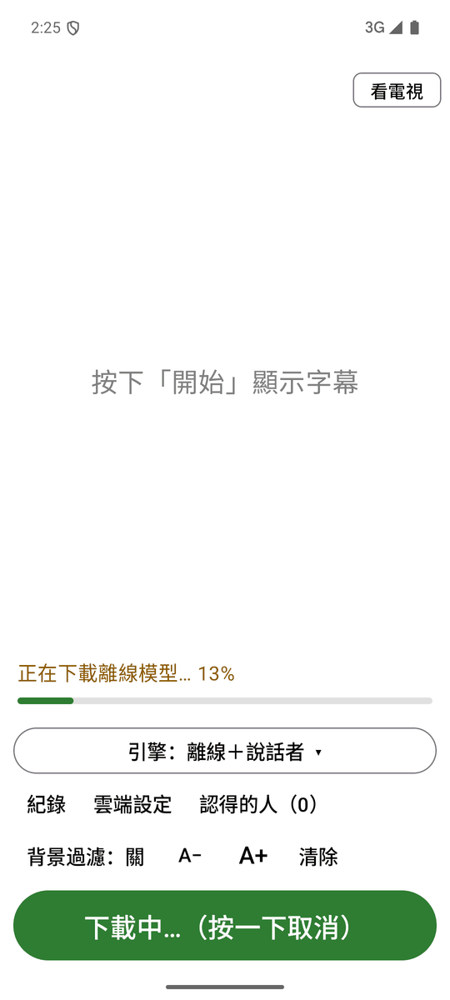

> 小提醒：下載中想取消，再按一次下方按鈕即可。

## 看字幕

按「開始」後，把手機放在說話的人附近，字幕就會一行一行出現。

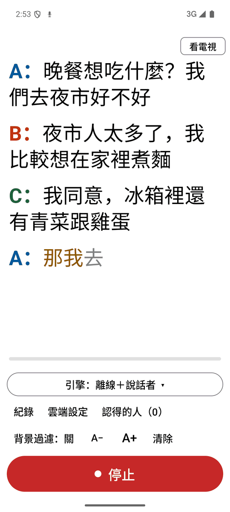

- **A、B、C：** 不同的人用不同字母和顏色。同一個人的字母會一直保持一樣。
- **灰色的字：** 還在聽、可能還會改的字；說完一句就會變成黑色。
- **下方的綠色細條：** 麥克風聽到的音量。完全不動的話，請確認麥克風沒有被擋住。
- **停止：** 按紅色的「停止」就不再收音。再按「開始」會接著上次的字幕繼續。

> 小提醒：字母是 App 依聲音猜的。聲音很像的兩個人（例如同性別、年紀相近）偶爾會被當成同一個人。

## 字體大小

按 **A−**／**A+** 把字變小或變大，下次打開會記住。

## 看電視模式

按右上角的「看電視」，字幕會變大、置中，不顯示 A、B、C，適合看電視或聽演講。再按一次回到一般模式。

- 想看前面的句子：在字幕上往下滑（往回看）。這時畫面不會被新的字拉走。
- 看完按「**↓ 回到最新**」回到最新一行，字幕會繼續跟著跑。

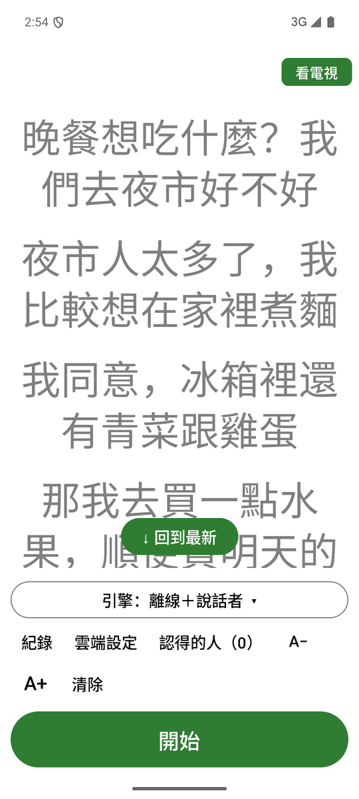

## 記住家人的聲音（長按命名）

在一句字幕上**長按**，會問「這句話是誰說的？」。輸入名字（例如「媽媽」）按「記住」，之後這個人說的話會直接顯示名字，不是 A、B。

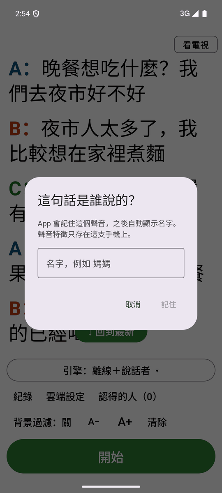 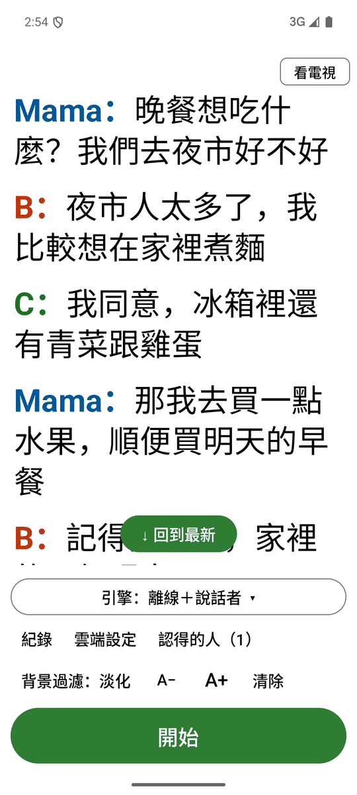

按下方的「**認得的人**」可以看到記住了誰，也可以：

- **改名：** 把名字改掉。
- **合併到…：** 同一個人被記成兩個名字時，合成一個。
- **忘記：** 不再認這個人（會先問你確定嗎）。畫面上的名字會變回 A、B。

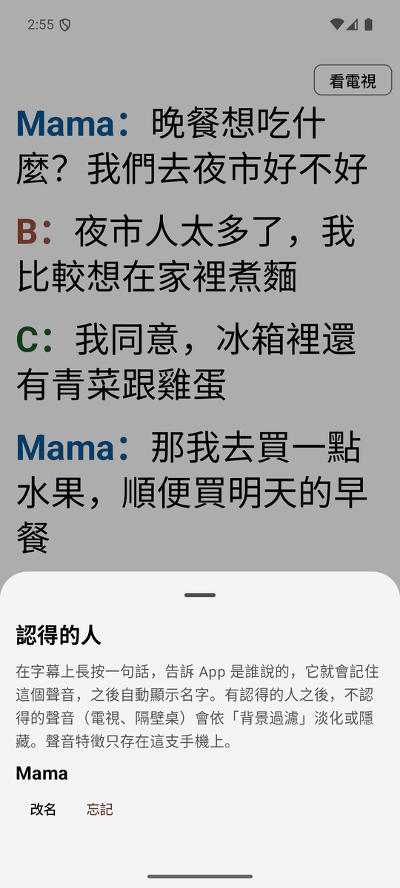

> 重要提醒：記住第一個人之後，「背景過濾」會自動改成「淡化」。這時**還沒記住的人**說的話會變成小小的灰色「背景：」字。家裡常說話的人最好都記一次；或是按下方「背景過濾」切到「關」，所有人的字都會正常顯示。

## 背景過濾

下方的「背景過濾」可以按著切換：

- **關：** 所有聲音都正常顯示（預設）。
- **淡化：** 認不出來的聲音（例如電視、隔壁桌）用小小的灰字顯示。
- **隱藏：** 認不出來的聲音直接不顯示。

> 小提醒：要先記住家人的聲音，App 才分得出誰是家人、誰是電視。

## 辨識引擎（離線／雲端）

按「引擎：離線＋說話者 ▾」打開設定。

**離線（在手機上）：** 模型下載到手機後就不用網路，也不花錢。

- 「離線＋說話者」：推薦，預設使用。
- 「離線＋說話者（省電）」：準確度差不多、比較省電，字慢約 0.1 秒，適合舊手機。要用時按「下載」。
- 不用的模型可以按「移除」，釋放手機空間。

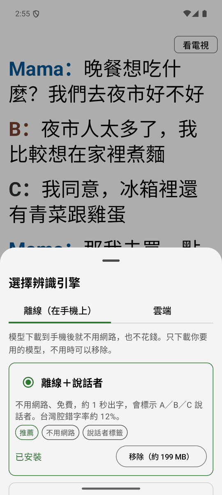

**雲端：** Azure 雲端辨識，台灣腔最準，但需要網路和你自己的 Azure 金鑰，照使用時間計費（見下方「雲端設定」）。

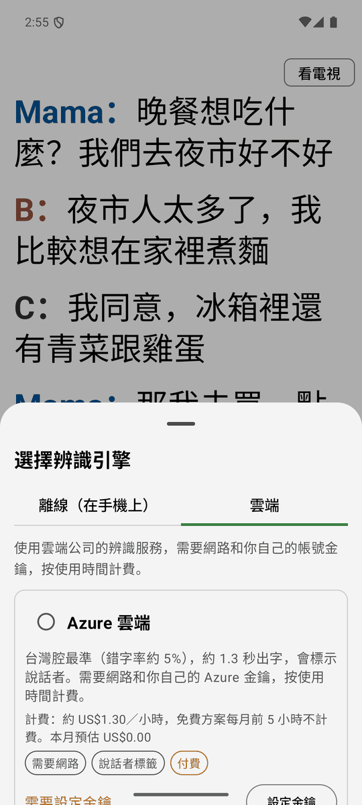

## 自訂詞彙、說話者、麥克風、外觀

同一個設定頁往下滑：

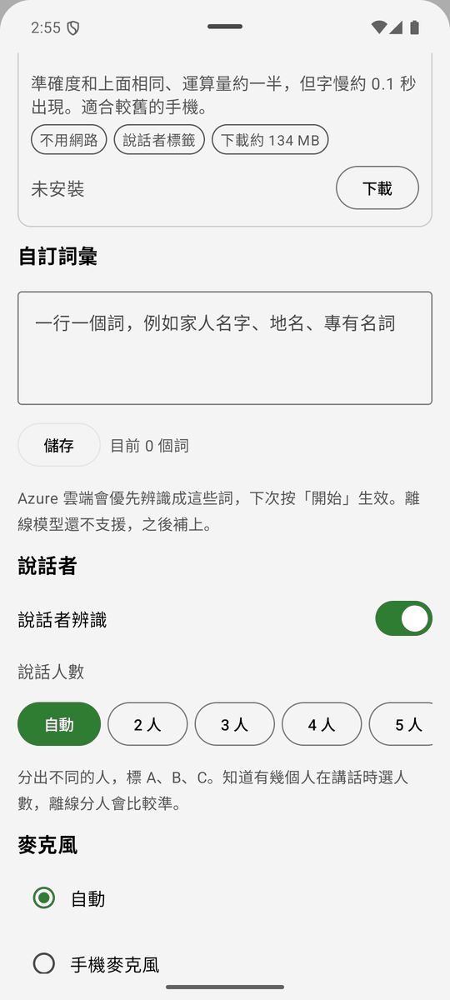 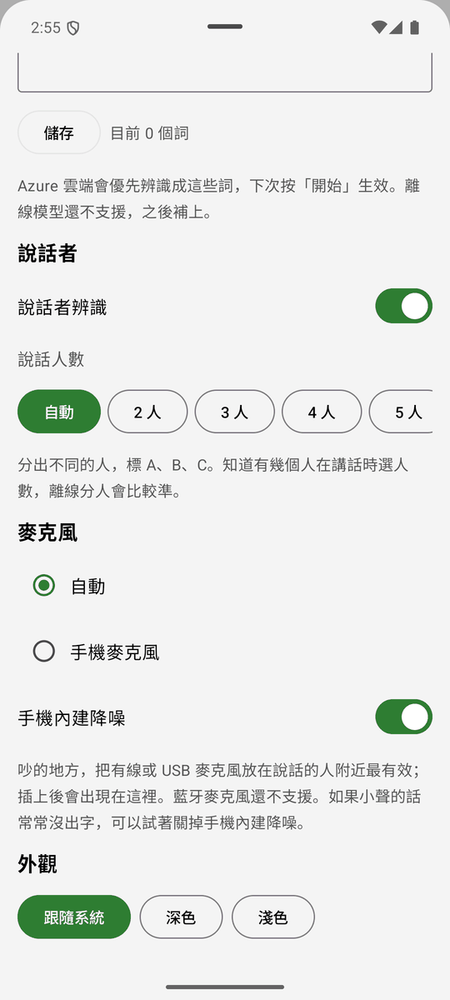

- **自訂詞彙：** 一行一個詞（家人名字、地名、店名），按「儲存」。目前只有 **Azure 雲端** 會用到；離線模型還不支援。
- **說話者辨識：** 關掉就不標 A、B、C，比較省電。
- **說話人數：** 知道有幾個人在說話時選人數（例如 2 人），分人會比較準。不確定就選「自動」。
- **麥克風：** 插上有線或 USB 麥克風時，可以在這裡選。藍牙麥克風（含藍牙耳機）還不支援。
- **手機內建降噪：** 預設開。小聲說話常常沒出字的話，可以試著關掉。
- **外觀：** 跟隨系統、深色、淺色。

深色外觀：

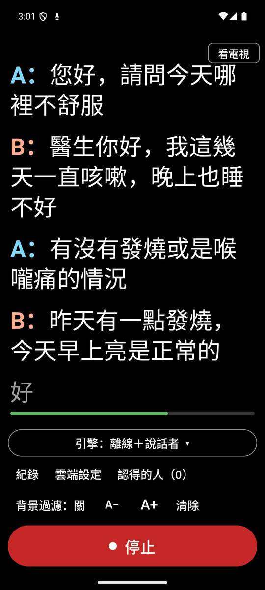 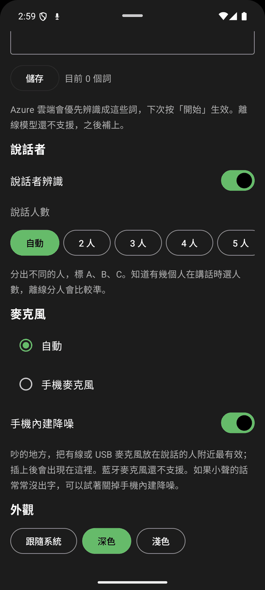

## 雲端設定（Azure 雲端、費用、AI 校稿）

按下方的「雲端設定」。這些都是**選用**的，不設定也能用離線辨識。

**Azure 語音服務：** 填入你自己在 Azure 申請的金鑰（KEY 1）和區域，按「儲存」，再按「測試連線」確認。金鑰會加密存在這支手機上，畫面只顯示最後 4 碼。

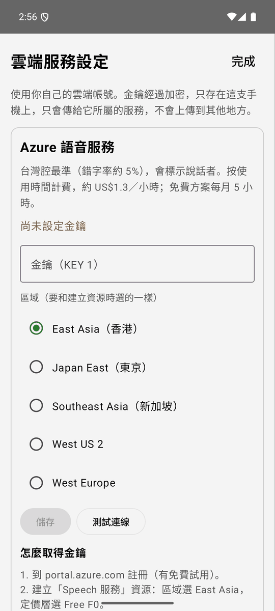

**雲端用量與費用：** 看今天／本月用了多久、大約多少錢。可以設「每月費用上限」：超過時會提醒你，並先改用離線辨識。

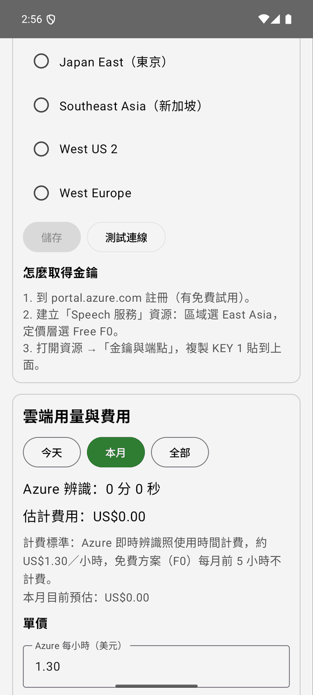

**AI 校稿（Claude）：** 說完一句約 2 秒後，請 AI 依上下文修正錯字和標點。只傳送字幕文字，不傳聲音。需要你自己的 Anthropic 金鑰，照用量計費；沒有金鑰時開關不能打開。

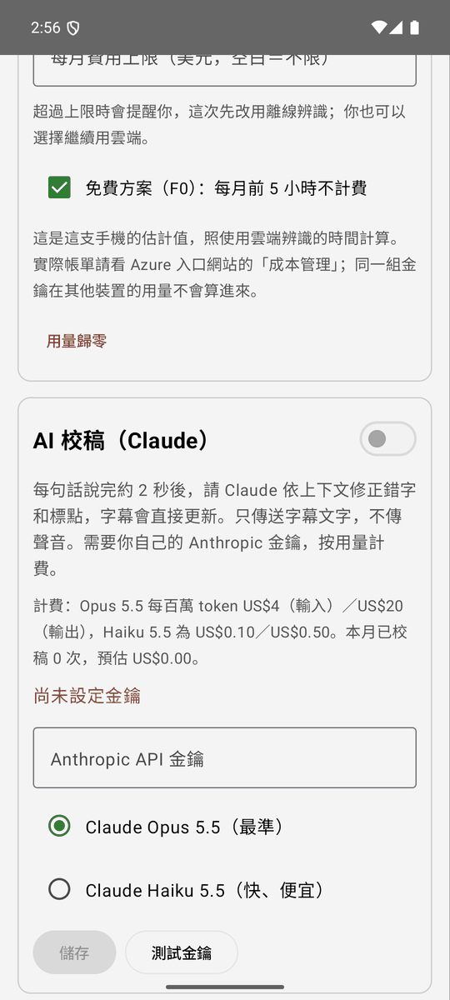

> 小提醒：如果用 Azure 時網路斷了，字幕會自動改用離線辨識，並出現黃色提示；按「停止」再「開始」會重新連雲端。

## 逐字稿紀錄

按下方的「紀錄」，每次的字幕都會自動存起來（只存在這支手機上，不存聲音）。可以搜尋標題或內容。

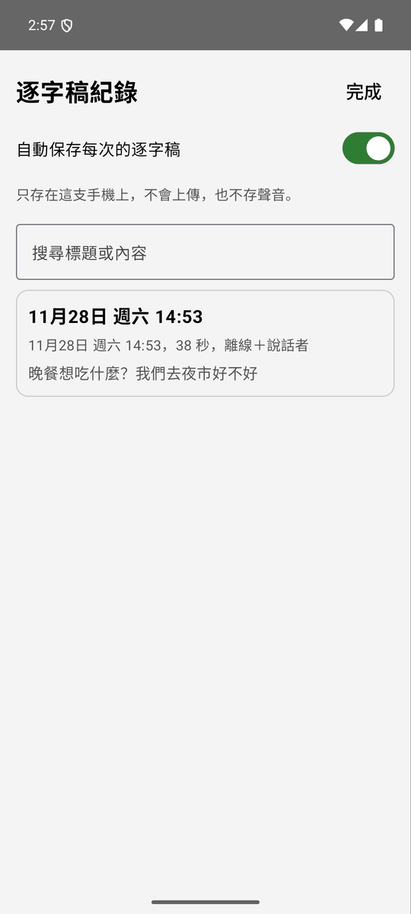 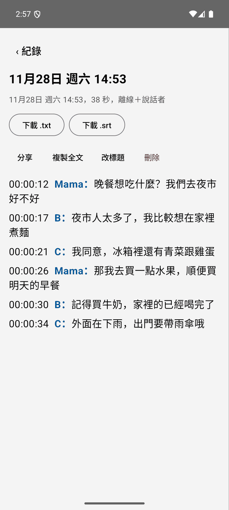

點進一篇可以：

- **下載 .txt：** 純文字檔。
- **下載 .srt：** 字幕檔，可以搭配影片使用。
- **分享**、**複製全文**、**改標題**、**刪除**。

> 小提醒：紀錄裡每一句前面的時間，是這句**說完**的時間，不是開始說的時間。

## 通知列

收音時通知列會顯示「即時字幕正在收音」。把通知往下拉開，可以直接按「停止」。

## 常見問題

**按了開始沒有字幕？**

- 確認有允許錄音：手機「設定 → 應用程式 → 即時字幕 → 權限 → 麥克風 → 允許」。
- 看下方的綠色音量條有沒有在動。沒動的話，麥克風可能被手、手機殼擋住，或被其他 App 佔用。
- 第一次使用要先下載模型，請連 Wi-Fi 等它下載完。

**A、B、C 字母不準？**

- 在「辨識引擎 → 說話者 → 說話人數」選正確的人數。
- 長按字幕把家人的名字記起來，之後會更準，也會直接顯示名字。
- 太短的話（例如只說「好」）可能不會標字母，這是正常的。

**電視聲也被打成字幕？**

- 先把家人的聲音都記起來（長按命名），再把「背景過濾」切到「淡化」或「隱藏」。
- 手機放在說話的人旁邊、離電視遠一點，效果最好。

**會不會花錢？**

- 離線辨識完全免費，下載模型後不需要網路。
- 只有你自己填了金鑰並選擇「Azure 雲端」或打開「AI 校稿」時，才會照用量計費。可以在「雲端設定」看用量，並設定每月上限。
